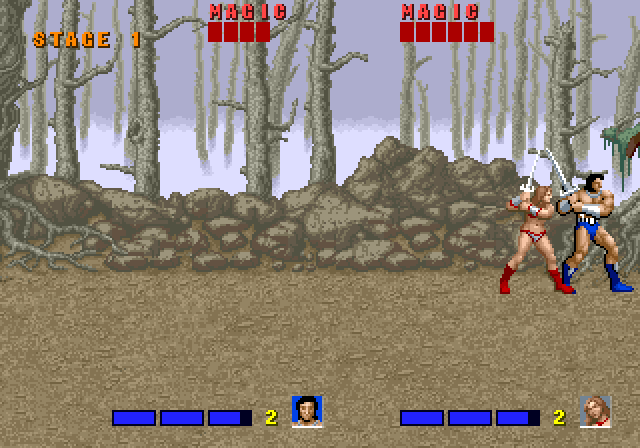

# Golden Axe RPG

A respin of the [Golden Axe browser port](../golden-axe) into an action RPG, built on the same
engine and the same ROM-derived art, sound and music. The fighting is still the arcade's; around
it:

- **A journey on the world map** (the parchment from the original's story scenes, its route
  painted out): the five areas and the camps between them, the way on opening as each boss falls.
- **Roaming**: an area scrolls both ways. Its scripted fights and boss play on the first visit;
  after that its foes turn up as random encounters. Walk off either end to return to the map.
- **Levels and skills** (`src/game/rpg.ts`): experience, damage numbers, enemies that grow
  tougher area by area, and three skill trees per hero, opened with pause: Weapon, Element (each
  of the hero's original magic levels as its own spell, cast with MP) and Survival.
- **Camps**: rest to heal and restore magic (thieves still creep in), and the journey is saved
  (in the browser's storage); the title screen offers to continue it.
- **Towns and quests** (`src/game/story.ts`): Turtle Village and Stone Town fill with people once
  freed (the original's villager sprites; gnome thieves turned traders). Talk with attack; traders
  sell food, tonics, elixirs and better weapons and armour for the gold foes drop; some townsfolk
  give quests. Each area has a few words on arrival and when its boss falls.
- **Champions and beasts**: now and then a foe comes as a glowing champion, tougher and carrying
  treasure (gold, things for the bag, sometimes better gear). Beasts grow with the foes beaten from
  their backs, and one being ridden comes along to the next area (and through a night at camp).
  Riders can cast from the saddle; jump makes the beast leap, and jumping again mid-leap hops off.

Tests for the new parts: `tests/roam.js`, `tests/rpg.js`, `tests/world.js`, `tests/town.js`, `tests/loot.js`,
`tests/fightcam.js`, `tests/leap.js` (with
`npm run dev` running, `npx tsx tools/play.ts tests/world.js http://localhost:5173/`). The port's
older tests in `tests/` drive the arcade flow and no longer apply.

The original port's README follows.

---

# Golden Axe — a browser port

**Play it at [golden-axe.atomic14.com](https://golden-axe.atomic14.com)** — on a desktop, with a
gamepad, or on your phone.



A port of the 1989 arcade game *Golden Axe* to the browser, written in TypeScript with Vite,
playable on a desktop, with a gamepad, or on a phone. It is not an emulator: the game logic has
been rewritten from scratch, while the graphics, animations, stage layouts, height maps, enemy
spawn scripts, sound effects and music come from the original arcade ROMs.

## Credits

**Golden Axe** was created by **Sega** (directed by Makoto Uchida)
and released in arcades in 1989. Everything that makes it *Golden Axe* — the characters,
artwork, music, sound effects, stage design and the game itself — is their work, and it is
owned by Sega.

This is a non-commercial fan project made out of admiration for the original. It is not
affiliated with or endorsed by Sega. All trademarks and copyrights in *Golden Axe* belong to
their respective owners. If you enjoy this, play the real thing.

The port leans heavily on:

- **[MAME](https://www.mamedev.org/)** and its developers. MAME's `segas16b` driver and
  `segaic16` video code document the System 16B hardware, and MAME's Lua scripting and
  debugger made it possible to watch the original game run: its sprite and tile RAM, its
  object table, its sound commands.
- **[4x-PixelPerfectV4](https://openmodeldb.info/models/4x-PixelPerfectV4)** (mutin-choler) and
  [spandrel](https://github.com/chaiNNer-org/spandrel) for the HD mode's art.
- [Vite](https://vitejs.dev/), [TypeScript](https://www.typescriptlang.org/) and
  [Playwright](https://playwright.dev/) (for driving the port in tests).

## Controls

| | Move | Attack | Jump | Magic | Run | Back attack |
|---|---|---|---|---|---|---|
| Keyboard | WASD / arrows | J or Z | K, X or Space | L or C | tap a direction twice, or hold Shift | Attack + Jump together |
| Gamepad | stick / d-pad | X | A | Y | tap twice, or hold a shoulder button | B |
| Touch | left thumb | right thumb | right thumb | right thumb | flick the stick twice | thumb on the seam between Attack and Jump |

Enter / Start starts, P / Esc or the **II** button pauses, M mutes. F, a gamepad's Select / Back
or the **HD** button cycles the display (remembered; CRT to start with): **original** pixels; **smooth**, Hyllian's
xBR pixel-art scaler, which rounds off the staircases along edges while keeping outlines hard;
**scale3x** (AdvMAME3x), the same idea in 3×3 blocks, so it stays pixelated; and **CRT**, an
arcade monitor with glowing scanlines, an aperture grille and curved glass. The filters are
WebGL shaders that redraw the 320×224 picture at the screen's full resolution (`src/filter.ts`).
The last mode, **HD**, is different: the game draws at 4× with sprites and backgrounds redrawn
by an AI upscaler (below), still in the original palettes, so recolouring, hit flashes, night
and the boss's sunset all still work. It loads its 16 MB of art the first time it is chosen.

### HD art

The HD sprites and backgrounds come from [4x-PixelPerfectV4](https://openmodeldb.info/models/4x-PixelPerfectV4)
(by mutin-choler, WTFPL), a sprite upscaling model from OpenModelDB, run locally:

```sh
npx tsx tools/upscale/export.ts /path/to/goldnaxe.zip work/upscale work/full.bin   # frames + palettes
uv run tools/upscale/upscale.py work/upscale/models/4x-PixelPerfectV4.pth work/upscale
npx tsx tools/upscale/pack.ts /path/to/goldnaxe.zip work/upscale/4x-PixelPerfectV4  # -> public/assets/hd
uv run tools/upscale/layers.py work/upscale/models/4x-PixelPerfectV4.pth            # backgrounds
```

Each sprite frame is exported in the palette the original drew it with most (counted from the
recordings), its transparent surround filled outwards from the edges so the model sees no false
background, and its colours and shape upscaled separately; every pixel then takes the nearest of
the frame's 14 colours, giving an indexed image the game can recolour like the original. The
backgrounds are upscaled whole per area, so there are no seams between tiles, and each 8×8 cell
is mapped back onto its own tile palette. Any model [spandrel](https://github.com/chaiNNer-org/spandrel)
loads can be swapped in.

### Computer partner

The select screen has a **CPU partner** option (up / down, or tap the line at the top): a
second hero, the next one along from yours, played by the computer (`src/game/partner.ts`).
It presses the same virtual stick and buttons a player would, so it plays by the same rules:

- it fights the nearest enemy it can reach, lining up in depth (hits only land within 6px)
  at swinging distance, helps out with whatever is going for you, turns round with a back
  attack when something closes in behind, and casts magic when crowded;
- it finds its way with a breadth-first search over the height map on screen, and jumps up
  ledges and over pits by playing each candidate jump through the game's own physics first;
- it follows you rather than leading (the camera follows people, not the partner), leaves
  food and potions for you unless you don't need them, and only takes a beast once you have one;
- out of lives, it rejoins after a few seconds; stuck far behind, it drops back in beside you.

`?cpu` turns the partner on from the URL, and `?auto` has the computer play player 1 as well.

### Touch controls

The arcade game is an 8-way stick and three buttons, and the moves that matter are built from
timing (double-tapping to run) and chords (attack + jump). The touch layout is designed around
that:

- **A floating stick for the left thumb.** It appears where the thumb lands, follows the thumb
  if it drifts past the rim, and reads 8 directions with a little hysteresis so diagonals don't
  flicker. **Running is the arcade's double tap**: flick the stick twice in the same direction
  (or lift and touch down again). Pushing to the rim never runs on its own, so you don't
  sprint off a ledge by accident. The knob turns gold while you run.
- **Three buttons for the right thumb**, in an arc around where the thumb rests: a large
  Attack, Jump up and to its right, and a smaller Magic further away.
  - Every touch on the right half goes to the nearest button, so near misses still count.
  - Sliding between buttons presses the new one (jump, then slide onto Attack for a jump attack).
  - A thumb on the **seam between Attack and Jump presses both** — the back attack.
  - **Magic spends every potion you have**, so it only fires from a fresh touch on it, never
    from a thumb sliding over it.
  - Phones that support it give a short vibration on each press.
- **Portrait** puts the screen at the top and the controls in the space below; **landscape**
  puts them in the margins beside the screen. The first tap goes fullscreen where the browser
  allows it (Android); on iPhone, use Share → Add to Home Screen to play fullscreen.

## How it was ported

The ROM set is treated as two things: a **data source**, and, run under MAME, a **reference**
to measure the new code against. The set is MAME's `goldnaxe` (set 6, US, with the 8751
protection MCU); its 68000 program is not encrypted, unlike the FD1094 sets.

1. **Hardware formats.** A software renderer for System 16B frames (`tools/render16b.ts`) —
   tilemap pages, scroll registers, the text layer, the sprite list and palette RAM — was
   checked pixel for pixel against MAME before anything else was built on it.
2. **Sprites.** The program ROM's frame table (`0x61320`) gives each of the 1,177 sprite
   frames' size and address in the sprite ROMs. Palettes are 14-colour sets at `0x37e04`,
   picked per object, so the atlas is kept indexed and recoloured in the browser.
3. **Animations.** Objects run animation scripts (interpreter at `0xbd54`): per step a frame,
   duration, flip flag, display offset and body box. Scripts were found by scanning the ROM
   and by collecting every script objects used in recordings. Mounted beasts have a second
   table after each script giving the rider's frame and offset per step.
4. **Stages.** The game streams each stage's tiles into a small virtual tilemap as it scrolls,
   so the stages were rebuilt from MAME recordings of a bot playing through the game: every
   visible tile is mapped to world coordinates and the most common tile per cell wins
   (`tools/levels.ts`). The same recordings give each stage's palettes (day, the boss's sunset,
   the night camp), the background parallax and the camera's vertical range.
5. **Height maps.** The game keeps a height map of the whole stage (one byte per 8×8 cell of
   x and depth) in unused tilemap pages; walls, ledges, stairs and pits all come from it.
   Like the original, heroes cannot climb on foot: ledges are jumped onto.
6. **Spawns.** Each area's enemy script (`0x38ee2`) lists when each enemy, thief, villager and
   beast appears, where, and with which parameters; scroll stops come from `0x38ea4`, and the
   bonus camps' thieves from `0x38ef6`. The init routines were identified by watching what
   each one put on screen.
7. **Hit testing** follows the original's own data: every attacking script has a header giving
   its damage, the reaction it causes, the step during which it hits and its attack box, found
   by tracing which code writes an enemy's health in MAME.
8. **Behaviour from recordings.** Scripted MAME runs measured the heroes' moves (walking at
   1.5 px/tick, running at 4, a 12-tick crouch then a 5.75 px/tick jump under 0.25 px/tick²
   gravity), enemy walking and running speeds, and each hero's spells at every
   level, which the port replays sprite for sprite.
9. **Sound.** Sound commands were sent to the sound board one per MAME run and recorded; a log
   of the commands the game sends (and from which code) named the effects, and the music
   table at `0x2a30` plus a log of what the sound CPU received placed the music. The voices
   (commands 0x41-0x54, the speech chip's samples) are the death screams: each enemy kind's
   knock-down code sends its own when the blow has emptied its health (`0x19592` for the
   soldiers), the heroes have one each, and the thieves laugh, giggle and cry.
10. **Hidden rules** found along the way: a 60-second timer (`0xffeca6`) that sends skeletons
   after players who go a minute without landing a blow, and the camps between areas, which
   the HUD counts as stages of their own.

The story maps between areas (the quill drawing the route while the story types out), the
select screen's backdrop and the ending are rendered from recordings of the original, the maps
and the ending as videos.

**Still approximate:** enemy AI (attack choice and timing), boss behaviour, magic damage, and
the transitions into the maps. Player 2 is computer-controlled only; there is no local
two-player mode yet.

## Building it yourself

The data extracted from the ROMs is checked in under `public/assets/`, so playing and building
only need Node:

```sh
npm install
npm run dev      # http://localhost:5173 (also on your LAN)
npm run build    # static site in dist/
```

To regenerate it from the ROM set (`goldnaxe.zip` as used by MAME; MAME also wants the PAL dump
`315-5298.b9`, which emulation doesn't need — a placeholder file works):

```sh
npm run extract -- /path/to/goldnaxe.zip work/full.bin   # sprites, anims, stages, spawns, magic
tools/record-audio.sh /path/to/rom-dir                    # sound (needs mame, ffmpeg, uv)
tools/record-magic.sh /path/to/rom-dir                    # spell recordings for extract
tools/record-title.sh /path/to/rom-dir /path/to/goldnaxe.zip
```

The playthrough recordings come from `tools/mame/bot.lua`, run with `OUT=work/full.bin`
(see the comments at the top of the script; `AREA=n` starts it in area n). From the same
recordings: `tools/select-bg.ts` renders the select screen's skull and `tools/render-video.ts`
the ending (with its sound, from a `-wavwrite` run). The story maps come from runs with
`MAPS=1 WEAK=1` (and `AREA=n` for the later ones), which leave the scenes between areas to play
out and record only those, every frame; `tools/map-videos.ts` cuts them into videos.

### Tests

`tools/play.ts` drives the game in headless Chrome (through Playwright, using the installed
Chrome) with scripts in `tests/`: an autoplayer that fights and paths through the stages
(`tests/flow.js` plays from area 0 through the camp and map into area 1; `tests/hits.js` maps
where each move lands and has each kind of bizarrian attack; `tests/partner.js` has the computer
play one or both heroes, `?cpu&auto`, and logs lives lost, pit falls, damage taken (and from
whom) and dealt, and anything that holds up the scroll), plus checks for the
touch controls (`tools/touchtest.ts`) and screenshots of the phone layouts (`tools/mobile.ts`).
Start `npm run dev` first; screenshots land in `work/shots`. `tools/demo-gif.ts` records the
GIF at the top of this page the same way, with the computer playing both heroes.

## Technical notes

System 16B: a 68000 at 10 MHz, a Z80 driving a YM2151 and a uPD7759, and an 8751 MCU.

- **Sprites** (sprite RAM `0x200000`, 8 words each): rows end at the first 4-pixel group whose
  last pixel is 15; pens 0 and 15 are transparent; the chip advances a row before drawing, so a
  frame's data rows 1..h are shown. Objects are anchored at the horizontal centre and the feet.
- **Objects** (`0xffc000`, `0x80` bytes): `+6` frame, `+0b` palette, `+0c` bit 7 facing left,
  `+10` x, `+14` depth, `+18` height (bigger is lower), `+28` animation script, `+70` health.
  Screen x = x − 0x1000 + camx + 8; screen y = z' − z'/4 + y' + camy (z', y' less 0x1000).
- **Camera**: camx = `0xffecf8` + `0xffed20`; progress (`0xffed32`) = 0x1000 − camx − 7,
  which spawn triggers and scroll stops compare against. The area is `0xffed4a`.
- **Hit testing** (`0xad26`): the 8 bytes before every animation script are an attack header —
  reaction (1, 2 hurt; 3, 4 kneed; 5 knocked down; 6 thrown; 0xc sent flying), damage, the
  active step, and an attack box (x1 x2 y1 y2, relative to the displayed position, facing right).
  While the active step plays, the box hits targets whose body box (`+0x68..+0x6e`) it overlaps
  within 6px of depth; the overlap test runs on the 315-5250 compare chip at `0x1f1000`.
- **Height map**: tile RAM `0xc000`, 64 bytes per 8px column, one per 8px of depth from
  0xf80; ground = value × 8 + 0xe00, 0 is a wall and ≥ 0xd0 a pit.
- **Sound**: commands reach the sound board through `0xffecfc` (the MCU forwards them) or the
  mapper's latch; 0x81–0xbf are effects, 0xc0–0xcc music, 0x26–0x40 set the volume.
